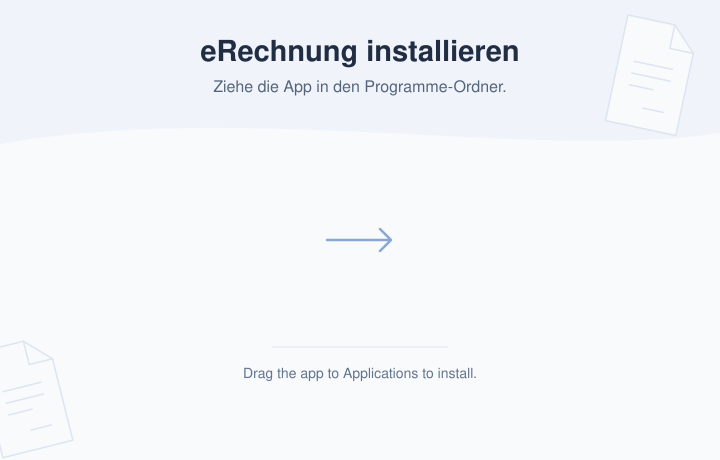

# E-Rechnung (ZUGFeRD & XRechnung)

Eine lokale Web-App zur einfachen Erstellung von E-Rechnungen für Freiberufler. Rechnungsexport als PDF/A-3 mit eingebettetem XML (**ZUGFeRD / Factur-X**) oder als XML mit PDF als Sichtexemplar (**XRechnung 3.0** nach EN 16931). Erstellung und Validierung laufen lokal. Bei optional freigegebenem Agentenzugriff kann der Agent Daten an seinen Anbieter übertragen. Optional als macOS-Doppelklick-App.

> **Status:** Persönliches Projekt, bereitgestellt **„wie besehen" (as is)**, ohne aktive Wartung oder Support. Der E-Rechnungs-Standard ändert sich jährlich. Bitte jede erzeugte Rechnung selbst prüfen (siehe Haftungsausschluss unten). Forks willkommen.

## Download (macOS)

Eine fertige, **signierte und notarisierte** macOS-App für Apple Silicon gibt es unter [Releases](../../releases).

- **Empfohlen: `eRechnung.dmg`** öffnen und eRechnung auf den Programme-Ordner im Fenster ziehen. Danach das Image auswerfen und die App aus Programme starten.
- **Alternativ: `eRechnung.app.zip`** herunterladen, entpacken und die App in den Programme-Ordner ziehen. Ältere Releases bieten ausschließlich das ZIP an.

Wer lieber aus dem Quellcode startet oder selbst baut: siehe unten.

## Änderungen bestätigen

Die App zeigt vor Änderungen bestehender Stammdaten, Kunden und gespeicherter
Positionen sowie vor Löschungen die betroffenen Daten und Folgen. Bestehende
Datensätze werden beim Tippen nicht mehr still überschrieben: Änderungen bleiben
bis zum ausdrücklichen Speichern im Formular. Neue Datensätze und unveränderte
Werte benötigen keine zusätzliche Bestätigung. Auch Kundenänderungen während der
Rechnungserzeugung werden vorher bestätigt.

Beim Kundenwechsel warnt die App vor ungespeicherten Änderungen. Abbrechen erhält
die Eingaben. Die Bestätigung gilt einmalig für fünf Minuten, für die aktuelle
Sitzung, Anfrage und den geprüften Datenstand. Geänderte oder wiederholte Anfragen
benötigen eine neue Bestätigung. Ohne JavaScript erscheint eine Bestätigungsseite.

Diese Bestätigung ist kein Nachweis eines menschlichen Bedieners und keine
Zugriffskontrolle gegen Programme mit direktem Datei- oder Bedienzugriff. Die
Prüfung und Schreiben verwenden die gemeinsame lokale Prozesssperre. Bestätigungen
sind an die laufende App gebunden; mehrere Macs bleiben unkoordiniert.

## Archiv und CSV-Auswahl

Das Archiv zeigt zunächst das aktuelle Jahr. Über die Jahresauswahl lassen sich
ältere Jahre oder alle Jahre anzeigen. Bei mehreren Ausstellern führt **Alle
Aussteller** auch die Belege deaktivierter Profile zusammen; jede Rechnung zeigt
ihren Aussteller. Dateiaktionen bleiben an diesen Aussteller gebunden.

**Auswählen** blendet Checkboxen für einzelne Rechnungen, ganze Quartale und alle
angezeigten Belege ein. Im Auswahlmodus markiert ein Klick auf die Rechnungszeile
(oder Enter/Leertaste auf der fokussierten Zeile) den Beleg; die Aktionsbuttons
bleiben separat bedienbar. **CSV exportieren** exportiert genau diese Auswahl
mit bis zu 10.000 Belegen pro Export. Beim
Sortieren bleiben Auswahlmodus und markierte Rechnungen erhalten. Beim Wechsel
von Jahr oder Aussteller wird die Auswahl geleert. Ohne
Buchungsdaten bleibt eine Datei sichtbar, kann aber nicht als CSV ausgewählt werden.
Die bisherigen CSV-Links je Rechnung und der Export per Datumsbereich bleiben
technisch verfügbar.

Vor jedem CSV-Export werden die gespeicherten Buchungsdaten mit der tatsächlichen
Rechnungs-XML abgeglichen: bei ZUGFeRD mit dem eingebetteten XML, bei XRechnung
mit der eigenständigen XML. Abweichende Beträge, Kunde, Nummer, Datum, Währung
oder Belegart sowie fehlende oder unlesbare Daten brechen den gesamten Export
ab. Reine PDF-Metadatenänderungen verhindern den Export nicht, wenn die XML-Werte
weiterhin übereinstimmen. Eine erneute erfolgreiche XML-Prüfung repariert keine
Abweichung zwischen Rechnung und Buchungsdaten. Der CSV-Abgleich selbst ist keine
neue XSD-/Schematron-Prüfung und ändert den gespeicherten Prüfstatus nicht.
Beim Export per Datumsbereich erfolgt der Abgleich vor dem Filtern. Widersprüche
auch bei scheinbar außerhalb liegenden Belegen brechen den Export ab, damit ein
veraltetes gespeichertes Datum keine Rechnung unbemerkt ausschließt.

Ändern sich die Quelldateien während des Exports, wird keine CSV ausgegeben.
Nach einem Datenordnerwechsel muss eine ältere Archivansicht vor dem Export neu
geladen werden. Beim Sprachwechsel bleiben die Einstellungen mit ihren
Archivfiltern und ausgewählten Rechnungen geöffnet, auch wenn das Archiv gerade
nachlädt. In diesem Fall wird die noch sichtbare Ansicht wiederhergestellt.

Die Liste bleibt durchgehend und wird insgesamt nach Erstellung, Nummer oder
Kunde sortiert. Die Quartalsauswahl erscheint nur im Auswahlmodus. Quartale richten
sich nach dem Rechnungsdatum; fehlt es bei einer älteren Datei, wird der angezeigte
Erstellungszeitpunkt verwendet. Ein Export aus der Ansicht **Alle Aussteller** enthält
eine zusätzliche Aussteller-Spalte. In der macOS-App werden solche Exporte im
Unterordner `exports` des Datenordners gespeichert und im Finder angezeigt.
Beim Wechsel des Datenordners werden diese CSV-Dateien mitgenommen. Abweichende
gleichnamige CSV-Dateien im Zielordner brechen den Umzug ab; keine Datei wird
überschrieben. Die Originale werden erst nach erfolgreichem Kopieren und Speichern
des neuen Speicherorts entfernt.

## Sicherer Entwicklungs-Testmodus

Für manuelle Tests ausschließlich `ERECHNUNG_TEST_MODE=1 ./run.sh` verwenden.
Die App startet standardmäßig auf Port 5001 mit einem neuen temporären Datenordner
und unabhängigem Nummernlauf. Die produktive Konfiguration wird nicht geladen,
der Datenordner kann nicht umgestellt werden, und beim normalen Beenden werden
die Testdaten entfernt. Nur fiktive Daten verwenden. Es gibt keine zusätzliche
Einstellung für Endnutzer. Automatisierte Tests isolieren bereits den App-Start.
## Robustere Rechnungsablage

PDF-Darstellung, Ausstellerverwaltung und Archivablage liegen in eigenständigen
internen Modulen. Vorschau und Erzeugung der App verwenden dieselbe Darstellung.
Die optionale MCP-Anbindung ist standardmäßig ausgeschaltet und erfordert eine separate Freigabe.

Ein Beleg wird nur nach erfolgreicher XSD- und Schematron-Prüfung archiviert.
Fehlt die Prüfung oder schlägt sie fehl, zeigt die App die Fehler; Belegdateien,
Kundendaten und Rechnungsnummernstand bleiben unverändert.

Das Archiv zeigt einen grünen **✓ XML**-Chip, wenn die technische XML-Prüfung für die aktuelle
Datei mit den aktuellen Prüfregeln bestanden wurde. Der Tooltip nennt die Prüfung
gegen XSD und Geschäftsregeln sowie den
Prüfzeitpunkt und die geprüfte Datei (bei XRechnung die XML, sonst das PDF mit
eingebettetem XML). Geänderte Dateien oder Prüfregeln erhalten einen neutralen
Hinweis auf eine nötige Neuprüfung; fehlgeschlagene Prüfungen erscheinen rot.
Über **⋯ → Prüfen / Erneut prüfen** ist die manuelle Prüfung jederzeit möglich.
Altbelege ohne gespeichertes Prüfergebnis erhalten erst nach einer Prüfung einen
Status. Ein gewöhnliches App-Update ohne geänderte Prüfregeln setzt ihn nicht zurück.
Prüfergebnisse werden separat gespeichert; die Belegdateien bleiben unverändert.
Die erneute Archivprüfung berücksichtigt das Dateiformat: Eine PDF-Datei muss
das XML eingebettet enthalten, eine XML-Datei wird direkt geprüft. Auch das
hinterlegte Rechnungsprofil wird berücksichtigt: Eine XRechnung darf nicht durch
eine normale EN-16931-Datei ersetzt werden und danach wieder einen grünen Haken
erhalten. Profilabweichungen werden angezeigt; der gespeicherte Status ist an das
geprüfte Archivprofil gebunden. Beschädigte Prüfzeitpunkte werden ignoriert und
blockieren das Archiv nicht. Beim Umzug
in einen Datenordner mit identischen Belegen werden die separaten Prüfergebnisse
des aktiven Ordners übernommen; unterschiedliche Prüfzeitpunkte sind kein
Rechnungsdatenkonflikt. Abweichende Belege blockieren den Umzug weiterhin.

Kann ein Prüfergebnis nicht gespeichert werden, zeigt die App einen Hinweis.
Das aktuelle Ergebnis bleibt während der laufenden Sitzung auch nach Neuladen
sichtbar; ein nicht gespeicherter Erfolg erhält keinen grünen Haken. Die App
entfernt nach Möglichkeit den älteren Status. Ist auch das wegen fehlender
Schreibrechte unmöglich, gilt die Anzeige des neuen Ergebnisses nur bis zum
App-Neustart. Nach Beheben des Speicherproblems bitte erneut prüfen.

Die Nummer gehört weiterhin zu einem Aussteller. Eine identische Wiederholung
verwendet die ursprünglichen Dateien. Abweichende Inhalte mit derselben Nummer
werden abgewiesen; vorhandene Altbelege bleiben bestehen. Das Archiv wird nicht
umbenannt oder nachträglich bereinigt.

Vor der Veröffentlichung werden die Dateien vollständig vorbereitet; das PDF wird
zuletzt sichtbar. Ein unterbrochener Schreibvorgang bleibt für die Wiederherstellung
vorgemerkt und wird beim nächsten schreibenden Zugriff abgeschlossen. Konflikte
mit zwischenzeitlich geänderten Dateien werden gemeldet, nicht überschrieben.
Die Sperre koordiniert Prozesse dieser App-Version auf demselben Rechner. Sie
koordiniert keine unterschiedlichen Macs über Dropbox oder andere Cloud-Synchronisation
und macht das Arbeitsarchiv nicht revisionssicher.

## Experimenteller Agentenzugriff (MCP)

Kompatible lokale MCP-Clients können freigegebene Aussteller und Kunden lesen,
Rechnungen prüfen, Vorschauen erzeugen und Änderungen anfragen. Die Funktion ist
hinter `ERECHNUNG_MCP=1` verborgen und benötigt zusätzlich dein Opt-in in den
Einstellungen. Jede Verbindung hat einen eigenen widerrufbaren Zugang und
explizit ausgewählte Aussteller und Kunden. Pro Änderungsaktion wählst du
**Verbieten**, **Nachfragen** oder **Erlauben**. Neue Verbindungen verbieten
Löschen und Deaktivieren standardmäßig; bei den übrigen Änderungen ist
**Nachfragen (empfohlen)** vorausgewählt. Kunden sind zunächst nicht freigegeben.
Nach der Einrichtung öffnet die Verbindung eRechnung bei Bedarf automatisch.
Das Starten erteilt keine zusätzlichen Rechte und aktiviert keinen widerrufenen
Zugang. Im isolierten Testmodus bleibt der App-Start manuell.

Löschen und Deaktivieren benötigen immer eine konkrete Bestätigung. Bestätigungen
können wahlweise in eRechnung oder in einem unterstützenden MCP-Client erscheinen;
bei fehlender Unterstützung bleibt die App verfügbar. Dauerhafte Rechte werden
nur in den Einstellungen geändert. Bestätigung im Client setzt Vertrauen voraus,
dass er die Entscheidung des Nutzers korrekt übermittelt; sie ist kein unabhängiger
Nachweis menschlicher Anwesenheit. Abweichende Rechnungen können bestehende
Archivbelege auch mit Bestätigung nicht überschreiben.

Einrichtung, Funktionsumfang und Sicherheitsgrenzen: [MCP-Anleitung](docs/mcp.md).

## Voraussetzungen

- **Python 3.12+**
- **Pango** — native Bibliothek, die WeasyPrint für die PDF-Erzeugung braucht (auch für die Web-App, nicht nur für den App-Build). Auf macOS: `brew install pango`.

## Start

Zwei Wege:

- **Im Browser** (Terminal): `./run.sh` legt beim ersten Mal automatisch ein virtuelles Environment an, installiert die Abhängigkeiten und startet die App. Dann im Browser öffnen: http://127.0.0.1:5000
- **Als macOS-Doppelklick-App** (ohne Terminal/Browser): siehe [Als macOS-App bauen](#als-macos-app-bauen-optional) — eigenes Fenster, self-contained.

Beim ersten Start einmal die **Stammdaten** (Absender) ausfüllen und speichern — sie werden lokal in `seller.json` abgelegt und bei jeder Rechnung wiederverwendet.

## Mehrere Rechnungsaussteller

Über **Weitere Stammdaten anlegen** unten links in den Stammdaten kannst du weitere Profile
anlegen, etwa für deine freiberufliche Tätigkeit und eine Gesellschaft. Jedes Profil
hat eigene Stammdaten, Steuerangaben, Logo, Bankverbindungen, Rechnungsnummern und
ein eigenes Archiv. Der Profilname dient nur zur Unterscheidung in der App; auf der
Rechnung steht der in den Stammdaten hinterlegte Name. Die Kundenliste und deren
gespeicherte Positionen werden gemeinsam genutzt.

Solange nur ein Profil vorhanden ist, bleibt die Oberfläche wie gewohnt. Ab dem
zweiten Profil zeigt die Kopfzeile der Stammdaten den aktiven Rechnungsaussteller
als Auswahl. Sie bleibt auch bei eingeklappten Stammdaten bedienbar. Beim Wechsel
bleibt eine geöffnete Stammdatenansicht geöffnet.

Die vorhandenen Stammdaten und Rechnungen bilden automatisch das erste Profil;
bestehende Dateien werden dafür weder verschoben noch umgeschrieben. Weitere
Profile liegen unter `issuers/<Profil-ID>/seller.json` und
`issuers/<Profil-ID>/output/` im gemeinsamen Datenordner. Ein Datenordnerwechsel
nimmt alle Profile mit; abweichende Kopien desselben Profils im Ziel stoppen den
Umzug. Sichere immer den vollständigen Datenordner.

Die automatische Nummernfolge `JJJJ-NNN` läuft pro Aussteller unabhängig. Der
Vorschlag folgt der höchsten Nummer des laufenden Jahres aus gespeichertem Zähler
und Archiv dieses Profils. Bei einem neuen Profil beginnt er mit `JJJJ-001`;
existieren Rechnungen außerhalb dieses Archivs, trage beim ersten Erstellen die
passende nächste Nummer ein. Abweichende Nummernformate bleiben manuell
eingebbar. Archiv, CSV-Export, Vorlagen und Bezüge für Korrekturen beziehen sich
jeweils auf das ausgewählte Profil. Gespeicherte Originalrechnungen bleiben bei
späteren Änderungen an den Stammdaten unverändert.

Bei einer **neuen Anschrift oder einem geänderten Namen** die vorhandenen
Stammdaten bearbeiten. Die Identität des Profils und seine Nummernfolge ändern
sich dabei nicht; neue Belege verwenden die aktualisierten Angaben.

Ein Profilwechsel öffnet ein neues Rechnungsformular. Bei bereits eingetragenem
Kunden oder Positionen fragt die App vor dem Verwerfen nach. Jedes Fenster behält
seinen eigenen Aussteller. Bei mehreren aktiven Profilen kannst du unter dem
Profilnamen **Als Standard verwenden** wählen. Dieses Profil wird beim nächsten
App-Start ausgewählt; ein manueller Profilwechsel verändert den Standard nicht.
Die Auswahl liegt in `issuer_preferences.json` im Datenordner und wird beim Umzug
mitgenommen. Ohne Auswahl oder nach dem Löschen des Standards wird das erste
noch aktive Profil geöffnet. Profile lassen sich über ihren Profilnamen umbenennen.

**Löschen** erscheint erst ab zwei aktiven Profilen und steht unten rechts neben
**Stammdaten speichern**. Nach Bestätigung wird das Profil aus der normalen Auswahl
entfernt, etwa nach Stilllegung einer Firma. Seine Stammdaten und Nummernfolge
bleiben für spätere Stornos und Korrekturen erhalten und sind nicht mehr bearbeitbar.
Alte Fenster können das Profil nicht durch automatisches Speichern wiederherstellen.

**Aussteller reaktivieren** macht dasselbe Profil wieder auswählbar, mit seinen
bisherigen Stammdaten, Rechnungen und seiner Nummernfolge. Die Aktion steht im
Archiv und im Dialog **Weitere Stammdaten anlegen** zur Verfügung, auch für
entfernte Profile ohne Belege. Der bisherige Standardaussteller bleibt bestehen.
Fenster aus der Zeit vor dem Löschen müssen ihre Stammdaten neu laden, bevor sie
Änderungen speichern können. Ein bewusst neu angelegtes Profil bleibt unabhängig;
gleiche Namen oder Adressen führen nicht zu einer automatischen Zusammenlegung.

**Das Archiv bleibt erhalten.** In den Einstellungen hat das Archiv eine eigene
Aussteller-Auswahl. Entfernte Profile sind dort als
**Nur Archiv** gekennzeichnet. Ihre Rechnungen lassen sich ansehen, herunterladen,
prüfen und als CSV exportieren. Im Menü einer Rechnung mit vollständig gespeicherten
Formulardaten stehen **Storno erstellen** und **Korrektur erstellen** zur Verfügung.
Der Aussteller und der Originalbezug sind fest hinterlegt; normale Rechnungen und
Vorausrechnungen bleiben gesperrt. Positionsrabatte und die ursprünglichen
Leistungszeiträume werden übernommen; Rechnungsnummer und Ausstellungsdatum sind neu.
Bereits früher entfernte Profile können die Absenderdaten aus der ausgewählten
Originalrechnung übernehmen. PDF, XML und
gespeicherte Rechnungsdaten einschließlich der damaligen Absenderangaben bleiben
unverändert. Ein Wechsel des Archivs lässt den aktuellen Rechnungsentwurf und seinen
Aussteller unangetastet.

**Schutz vor veralteten Stammdaten:** Ein geöffnetes Formular merkt sich den
geladenen Stand. Hat ein anderes Fenster oder eine bereits eingetroffene
Synchronisation die Stammdaten inzwischen geändert, wird das Speichern abgewiesen.
Die App zeigt einen Hinweis und bietet **Aktuelle Stammdaten laden** an; der
Rechnungsentwurf bleibt dabei erhalten. Die Prüfung reserviert keine Rechnungsnummern.
Der Export wartet auf das Speichern und die Konfliktprüfung der Stammdaten.

Paralleles Schreiben auf mehreren Macs mit getrennten synchronisierten Kopien ist
weiterhin nicht abgesichert. Die lokalen Simulationen und der noch ausstehende Test
mit zwei echten Macs sind in [Mehrgeräte-Prüfung](docs/multi-device-validation.md)
beschrieben.

## Steuerliche Behandlungen

| Auswahl | EN-16931-Code | Verwendung |
|---|---|---|
| Inland 19 % / 7 % | `S` | Normale Inlandsrechnung |
| Reverse Charge – EU B2B | `AE` | Leistung an EU-Unternehmen (USt-IdNr des Kunden nötig) |
| Reverse Charge – Drittland | `AE` | Dienstleistung an Nicht-EU-Unternehmer (§ 3a Abs. 2 UStG), 0 % mit Begründung |
| Nicht steuerbar – Drittland (ohne USt-IdNr) | `G` | Drittland-Kunde ohne USt-IdNr, 0 % mit Begründung |
| Kleinunternehmer § 19 | `E` | Keine USt nach § 19 UStG |

Bei den 0-%-Varianten wird der gesetzlich erforderliche **Begründungstext** automatisch in PDF und XML eingetragen.

**Eine Rechnung = ein Steuersatz.** Gemischte Sätze auf einer Rechnung (z. B. 19 % Designleistung + 7 % Einräumung von Nutzungsrechten, § 12 Abs. 2 Nr. 7c UStG) werden bewusst nicht unterstützt — stelle dafür einfach **zwei separate Rechnungen**, jede für sich mit einem Satz. Das ist steuerlich einwandfrei und hält das Tool einfach.

## Sprache (Deutsch / Englisch)

- **Oberfläche:** Umschalter **DE/EN** oben rechts (wird per Cookie gemerkt).
- **Rechnungssprache:** pro Rechnung im Dropdown wählbar — so kannst du bei deutscher Oberfläche trotzdem eine **englische Rechnung** an ausländische Kunden senden. Beschriftungen, Pflichthinweise und der steuerliche Begründungstext erscheinen dann in der gewählten Sprache (in PDF *und* XML).

## Was erzeugt wird

Das Format wählst du pro Rechnung oben im Kopf:

- **ZUGFeRD / Factur-X** (Standard): ein **PDF/A-3** mit lesbarem Rechnungslayout und eingebettetem **`factur-x.xml`** (Profil EN 16931 / „COMFORT") — ein Hybrid-Dokument, das zugleich Sicht- und Datenbeleg ist.
- **XRechnung 3.0**: eine eigenständige, einreichbare **`.xml`** (XSD- und BR-DE-valide) plus ein **PDF als Sichtexemplar**. Hier ist die XML die eigentliche Rechnung; das PDF dient nur der menschlichen Ansicht.

Beide werden gegen die offizielle XSD validiert; das Ergebnis lässt sich zusätzlich mit Validatoren wie dem [KoSIT-Validator] oder Mustang prüfen.

## Hinweise

- Die E-Rechnungs-**pflicht** (ab 2025 Empfang, gestaffelt ab 2027/2028 Versand) gilt nur für **inländische B2B-Umsätze**. Rechnungen an Nicht-EU-Kunden sind freiwillig, lassen sich hier aber im selben Format erzeugen.
- Dies ist ein Werkzeug, keine Steuerberatung. Die korrekte steuerliche Einordnung im Einzelfall liegt bei dir bzw. deinem Steuerberater.
- **Aufbewahrung / GoBD:** Dies ist ein **Rechnungs-Generator, kein revisionssicheres Archiv.** Der `output/`-Ordner ist eine Arbeitskopie — Dateien sind dort änder- und löschbar, es gibt kein Änderungsprotokoll. Bewahre deine Rechnungen **revisionssicher** dort auf, wo deine Buchhaltung liegt (z. B. DATEV/Steuerberater oder ein GoBD-konformes System). Aufbewahrungsfrist: **10 Jahre** (§ 14b UStG, § 147 AO).

## Als macOS-App bauen (optional)

Für eine Doppelklick-App ohne Terminal/Browser (eigenes Fenster via pywebview) gibt es einen PyInstaller-Build. Voraussetzung ist Homebrew-Pango (liefert die nativen Bibliotheken, die ins Bundle eingebettet werden):

```bash
brew install pango
.venv/bin/pip install -r requirements-build.txt
./build_macos.sh        # -> dist/eRechnung.dmg + dist/eRechnung.app.zip
```

Die App ist self-contained (Pango-Stack + SaxonC sind eingebettet) und legt ihre Daten unter `~/Library/Application Support/eRechnung` ab. Der Build prüft die nativen Bibliotheken automatisch, auch nach dem Entpacken des ZIPs und dem Kopieren aus dem DMG. Die fertigen Downloads lassen sich erneut prüfen:

```bash
.venv/bin/python scripts/check_macos_release.py --version "$(.venv/bin/python -c 'from version import __version__; print(__version__)')" \
  --archive dist/eRechnung.app.zip --dmg dist/eRechnung.dmg --unsigned
```

So gebaut ist die App **unsigniert** — auf einem fremden Mac blockt Gatekeeper sie dann beim ersten Start (danach unter **Systemeinstellungen › Datenschutz & Sicherheit** auf **„Trotzdem öffnen"**; der frühere Rechtsklick-›-Öffnen-Weg ist ab macOS 15 Sequoia weg). Für den fertigen, ohne Warnung lauffähigen Download siehe [Releases](../../releases).

Für einen **signierten + notarisierten** Build (wie in den Releases) unterstützt das Skript Code-Signing und Notarisierung über die Umgebungsvariablen `SIGN_IDENTITY` und `NOTARY_PROFILE` (Apple Developer Program nötig; Details im Kopf von `build_macos.sh`). Der klassische Start über `run.sh` / `start.command` bleibt unverändert nutzbar.

Das Bundle wird in einem temporären lokalen Ordner gebaut, damit synchronisierte
Projektordner keine zusätzlichen Finder-Metadaten in die Signatur einbringen.
Erst nach erfolgreicher Prüfung werden die Downloads nach `dist/` kopiert.
Das DMG verwendet ein festes Finder-Layout mit App und Programme-Verknüpfung.
Der helle Hintergrund liegt als editierbare Vektordatei in
[`assets/dmg-background.svg`](assets/dmg-background.svg); `scripts/build_dmg.py`
rendert daraus einen Hintergrund für normale und Retina-Displays. Zum Anpassen
der Symbolpositionen oder Fenstergröße dient die Konfiguration in diesem Skript.
Der Build benötigt dafür keine Finder- oder AppleScript-Automation.



## Lizenz & Haftungsausschluss

Dieser Code steht unter der **Apache License 2.0** – siehe [`LICENSE`](LICENSE). Mitgelieferte Drittkomponenten (u. a. die Schematron-Artefakte und die IBM-Plex-Schriften) stehen unter eigenen Lizenzen; die vollständige Auflistung mit Attribution findest du in [`THIRD_PARTY_NOTICES.md`](THIRD_PARTY_NOTICES.md).

**Ohne Gewähr.** Dieses Tool wird bereitgestellt „wie besehen", ohne jede Gewährleistung. Es wird keine Haftung für die Richtigkeit, Vollständigkeit oder rechtliche bzw. steuerliche Konformität der erzeugten Rechnungen übernommen. Bitte prüfe jede Rechnung selbst (bei Bedarf mit deinem Steuerberater). Die Nutzung erfolgt auf eigenes Risiko.

[KoSIT-Validator]: https://github.com/itplr-kosit/validator


## Automatische Prüfungen und Releases

### Hinweise auf neue Funktionen

`whats_new.py` enthält die kuratierten Highlights für „Neu in eRechnung“ (Deutsch
und Englisch). Bei neuen Hinweisen die `id`, die zugehörige `version` und die kurzen
Texte gemeinsam aktualisieren. **Nur bei ausgewählten größeren Feature-Releases**
`auto_open: True` setzen. Bei kleineren Neuerungen und Fehlerkorrekturen bleibt es
`False`; ohne dieses Feld öffnet sich der Dialog ebenfalls nur manuell. Eine neue
ID oder Versionsnummer allein löst keine automatische Anzeige aus. Die Hinweise
zum Archiv und CSV-Export in 1.3.0 erscheinen einmalig automatisch. `ANNOUNCEMENT = None` deaktiviert
den Dialog und den Menüeintrag vollständig.

Die App speichert gelesene IDs in ihrer lokalen `config.json`, unabhängig vom
Browser-Speicher und vom gewählten Rechnungsordner. Die erste Ordnerauswahl hat
Vorrang; über „Neuigkeiten“ in den Einstellungen bleiben die Hinweise erreichbar.

### Prüfungen

Bei Pull Requests und Pushes auf `main` laufen Python-Tests einschließlich echter
PDF-Erzeugung, XSD- und Schematron-Prüfung, JavaScript-Tests, Ruff und mypy. Die
Integrationstests prüfen ZUGFeRD und XRechnung jeweils auf Deutsch und Englisch.
Fehlende PDF-/SaxonC-Abhängigkeiten sind in CI ein Fehler.

Ein zusätzlicher Apple-Silicon-Job auf `macos-15` baut die App. Der Build prüft die
Versionsnummer und führt den Selbsttest sowohl im Bundle als auch nach dem
Entpacken des ZIP-Archivs und Kopieren aus dem DMG aus. Diese CI-Builds benötigen keine Apple-Zugangsdaten
und gelten nicht als signierte Veröffentlichungen. Der Selbsttest verwendet
bereits beim Laden der App einen temporären Datenordner.

Für lokale Prüfungen:

```bash
.venv/bin/python -m pip install -r requirements.txt -r requirements-dev.txt pypdf==6.12.2
ERECHNUNG_REQUIRE_INTEGRATION=1 .venv/bin/python -m pytest -q
./build_macos.sh
```

Bei einem Build mit `NOTARY_PROFILE` prüft das Skript den Apple-Zugriff vor dem
Aufräumen und Bauen. Nach Signierung und Notarisierung werden zusätzlich die
Developer-ID-Signatur, das angeheftete Notarisierungsticket und Gatekeeper geprüft,
auch am entpackten ZIP und der aus dem DMG kopierten App. Das DMG selbst wird
ebenfalls signiert, notarisiert und geprüft. Eine fehlende Notarisierung ist ein Fehler.

Der manuell startbare GitHub-Ablauf **Release verification** prüft ein bereits
hochgeladene Release-Dateien (auch aus einem Entwurf): Tag, Quellcode-Version,
Änderungsprotokoll, App-Version, Signatur, Notarisierung und Selbsttest. Dazu unter
**Actions → Release verification → Run workflow** den Tag angeben. Mit der optionalen
Auswahl **Nach erfolgreicher Prüfung veröffentlichen** wird der Entwurf erst nach
allen Prüfungen veröffentlicht; vor der Veröffentlichung werden die Prüfsummen
beider Downloads erneut verglichen. Neue Releases müssen `eRechnung.dmg` und
`eRechnung.app.zip` enthalten. Ältere Quellstände ohne DMG-Build bleiben mit ihrem
ZIP allein prüfbar. In den Release-Notizen steht der DMG-Download vor der ZIP-Alternative.
Ohne diese Auswahl wird nur geprüft.
Apple-Zertifikate oder Apple-Passwörter müssen dafür nicht in GitHub gespeichert werden.

Zum Vorbereiten eines Release-Entwurfs beide Dateien hochladen (Version und
Release-Notizen zuvor aktualisieren):

```bash
TAG="v$(.venv/bin/python -c 'from version import __version__; print(__version__)')"
gh release create "$TAG" --verify-tag --draft --notes-file release-notes.md \
  'dist/eRechnung.dmg#macOS – DMG (empfohlen)' \
  'dist/eRechnung.app.zip#macOS – ZIP (Alternative)'
```
